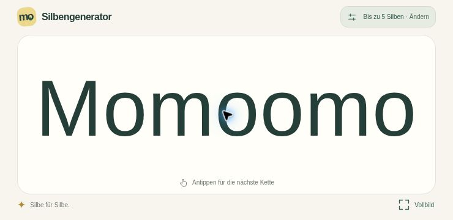
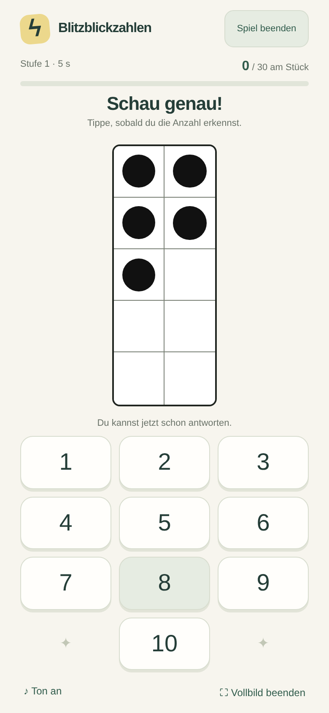

# Games · Kleine Lernspiele

Zwei Lernspiele für Kinder, als installierbare Web-Apps für Android gebaut.
Beide verwenden dieselben ruhigen Farben, große Bedienelemente und einen eigenen Offlinecache.
Der Code wird in diesem Repository gepflegt.

| Spiel | Übung | Ausrichtung | Spieladresse über ChatGPT Sites |
| --- | --- | --- | --- |
| **Silbengenerator** | Silbenketten lesen | Querformat | https://silbengenerator-simonbl778.groovychair.chatgpt.site |
| **Blitzblickzahlen** | Mengen von 1–10 auf einen Blick erkennen | Hochformat | https://blitzblickzahlen-simonbl778.groovychair.chatgpt.site/blitzblickzahlen/ |

Die gemeinsame Startseite unter https://blitzblickzahlen-simonbl778.groovychair.chatgpt.site/ bietet die Auswahl beider Spiele. Der Zugriff erfolgt wie beim bisherigen Silbengenerator über das eigene ChatGPT-Konto. Für diese Spieladressen muss GitHub Pages nicht aktiviert werden.

## Silbengenerator

Eine große Silbenkette lesen, antippen und weiterlesen.



## Spielen

**Eigenständige Silbengenerator-App ohne ChatGPT-Anmeldung:**
[APK herunterladen](https://github.com/simonbl778/Games/raw/refs/heads/main/downloads/Silbengenerator-1.0.1.apk).
Diese Datei lässt sich auch auf OneDrive ablegen und per Link weitergeben.
Die App funktioniert ab Android 8 und von Anfang an vollständig offline.
[Installation und Weitergabe](downloads/README.md) · [Android-Quellcode und Build](android/README.md)

**Silbengenerator öffnen:** https://silbengenerator-simonbl778.groovychair.chatgpt.site

**Blitzblickzahlen öffnen:** https://blitzblickzahlen-simonbl778.groovychair.chatgpt.site/blitzblickzahlen/

Beide Spiele bieten auf ihrer Auswahlseite **Aufs Handy** zum Installieren. Nach dem vollständigen Laden zeigt **Offline bereit** an, dass das jeweilige Spiel ohne Internet genutzt werden kann. GitHub Pages bleibt eine optionale weitere Bereitstellung.

## Auf einem Android-Handy starten

1. Die veröffentlichte Spieladresse in **Google Chrome** öffnen.
2. Eine Höchstzahl von **1 bis 5** wählen und **Lesen starten** antippen.
3. Das Handy quer halten. Die App fordert beim Start Vollbild und Querformat an, soweit der Browser es erlaubt.
4. Die große Silbenkette antippen: Die nächste Kette erscheint. **Ändern** führt zur Auswahl zurück.

Ein APK, Android Studio, Entwickleroptionen und ein Play-Store-Eintrag werden nicht benötigt.

### Wie eine App installieren

In Chrome das Dreipunkt-Menü **⋮** öffnen und **Installieren und Verknüpfung erstellen → Installieren** auswählen. Je nach Chrome-Version heißt der Eintrag **Zum Startbildschirm hinzufügen → Installieren**. Das Spiel hat dafür auch die Schaltfläche **Aufs Handy**.

Nach der Installation über das eigene App-Symbol starten. Sobald auf der Auswahlseite **Offline bereit** angezeigt wird, sind alle notwendigen Spieldateien zwischengespeichert. Von diesem Gerät aus funktioniert das Spiel dann auch ohne Internet. Der Browser kann diese Daten entfernen, etwa wenn Website-Daten gelöscht werden. In diesem Fall einmal mit Internet neu öffnen.

Die Browseransicht in einer anderen App kann Installieren, Vollbild oder Drehen einschränken. In diesem Fall den Spiel-Link direkt in Chrome öffnen. Falls sich der Bildschirm nicht automatisch dreht, Androids automatische Drehung einschalten und das Handy drehen.

## Spielregeln

- Verfügbare Bausteine: **Mo, Mi, Mu, i, o, u**.
- Die gewählte Zahl ist eine **Höchstzahl**, keine feste Kettenlänge. Bei `1` erscheint immer eine Silbe, bei `2` zufällig eine oder zwei. Bei `3` entstehen Ketten aus zwei oder drei, bei `4` aus drei oder vier und bei `5` aus vier oder fünf Bausteinen.
- Jeder einzelne Vokal zählt als eine Silbe. `iou` besteht damit aus drei Bausteinen.
- Jeder Baustein kann innerhalb derselben Kette mehrfach vorkommen.
- Nur der **erste Buchstabe der gesamten Kette** wird zufällig groß- oder kleingeschrieben. Alle weiteren Buchstaben bleiben klein: zum Beispiel `Momiu` oder `momiu`, aber nicht `MoMiU`.
- Jede neue sichtbare Anzeige unterscheidet sich von der unmittelbar vorherigen.
- Die App zeigt beim erneuten Öffnen zuerst die Auswahl. Die zuletzt verwendete Höchstzahl ist lediglich vorausgewählt.
- Die Schriftgröße passt sich an die Kettenlänge und den verfügbaren Platz an. Die Kette bleibt in einer Zeile.

Im Silbengenerator gibt es keinen Zeitdruck, keine Punkte, keine Werbung, keine Tonwiedergabe und keine Spielerkonten. Das Spiel selbst sendet keine Lern- oder Nutzungsdaten. Es speichert lokal nur die letzte Auswahl und die Dateien für den Offlinebetrieb; das Hosting hat seine üblichen technischen Zugriffs- und ggf. Anmeldedaten.

## Blitzblickzahlen

Ein Blitzblick-Spiel für Erstklässler: schwarze Punkte auf einem weißen Zehnerfeld kurz anschauen und die Anzahl wählen, sobald sie erkannt wurde.



1. Die Spieladresse in Chrome öffnen und eine der zehn Stufen wählen.
2. **Los geht’s** antippen und das Handy hoch halten. Die App fordert Vollbild und Hochformat an, soweit der Browser es erlaubt.
3. Nach „Mach dich bereit“ erscheint das Zahlbild. Das Feld wird zeilenweise von oben links nach unten rechts gefüllt: erst beide Punkte der obersten Reihe, dann die nächste Reihe. Bei ungeraden Zahlen steht der letzte Punkt links. Die Zahl selbst wird nicht verraten.
4. Die Anzahl auf den Telefontasten **1–9** oder auf der mittigen Taste **10** wählen: bereits während der Punkteanzeige oder danach. Eine frühe Antwort blendet das Feld sofort aus und beendet die Frage. Ohne Antwort verschwindet es nach der gewählten Zeit; die Tasten bleiben danach frei. Zum Antworten gibt es keine Zeitbegrenzung.
5. Richtig: weicher, glockenartiger „Bling“-Ton und lächelndes Gesicht. Falsch: kurzer absteigender „Zonk“-Ton, Daumen nach unten und die richtige Anzahl; die Serie beginnt wieder bei null. **Ton aus** schaltet alle Rückmeldetöne stumm. Bei der nächsten Aufgabe sehen alle Zahlentasten wieder gleich aus.
6. Nach **30 richtigen Antworten hintereinander** gibt es einen Pokal, Konfetti und eine fröhliche Siegermelodie mit aufsteigenden Glöckchen und einem Dur-Akkord. Danach erneut spielen oder die Stufe wechseln.

| Stufe | Sichtbare Dauer |
| --- | --- |
| 1 · ganz leicht | 5 s |
| 2 | 4 s |
| 3 | 3 s |
| 4 | 2,5 s |
| 5 | 2 s |
| 6 | 1,5 s |
| 7 | 1 s |
| 8 | 0,7 s |
| 9 | 0,5 s |
| 10 · ganz schwer | 0,3 s |

Jede Zahl ist anfangs gleich wahrscheinlich. Falsche Antworten erhöhen die Gewichtung der **gesuchten** Zahl schrittweise bis zum Dreifachen. Richtige Antworten senken die zusätzliche Gewichtung allmählich wieder. Alle Zahlen bleiben möglich; direkte Wiederholungen sind erlaubt. Diese Anpassung und die Serie gelten nur für die aktuelle Partie. **Spiel beenden** führt jederzeit zur Schwierigkeitsauswahl zurück und stoppt die Partie samt Ton. **Noch einmal spielen** oder ein Neuladen beginnen ebenfalls eine neue Session. Nur die letzte Stufe und die Toneinstellung bleiben lokal gespeichert.

Beim App-Wechsel wird das Spiel angehalten. Nach **Weiter geht’s** wird ein unterbrochenes Zahlbild erneut für die volle Dauer gezeigt. Eine bereits offene Antwort bleibt offen. Versteckte Zeit zählt nicht als Fehler. **Ton an/aus** schaltet die Melodien um. Am Computer entsprechen die Tasten `1`–`9` den Zahlen, `0` steht für `10`.

Installation und Offlinebetrieb funktionieren wie beim Silbengenerator über **Aufs Handy**. Jedes Spiel hat ein eigenes Symbol und einen eigenen Service-Worker-Bereich; die Offlinecaches beeinflussen sich nicht. Töne werden direkt im Browser erzeugt und funktionieren ebenfalls offline. Es gibt keine Werbung, Konten oder Übertragung von Lerndaten. Die tatsächliche Installation, Ausrichtungssperre und Tonwiedergabe bitte zusätzlich auf dem Android-Zielgerät prüfen.

Die neuen Dateien stehen in [`docs/blitzblickzahlen/`](docs/blitzblickzahlen/): `game.js` enthält Zeitstufen, Zahlbilder, Fehlergewichtung und Spielende; `app.js` steuert den Ablauf und die Handyfunktionen; `audio.js` erzeugt die Melodien. Die Spielregeln sind in [`tests/blitzblickzahlen.test.mjs`](tests/blitzblickzahlen.test.mjs) geprüft.

## GitHub Pages optional einschalten

1. Im Repository **Games** zu **Settings → Pages** gehen.
2. Unter **Build and deployment → Source** die Option **Deploy from a branch** wählen.
3. Als Branch **main** und als Ordner **/docs** auswählen.
4. **Save** anklicken und die Veröffentlichung abwarten. GitHub nennt dafür bis zu etwa zehn Minuten.
5. Danach https://simonbl778.github.io/Games/silbengenerator/ öffnen.

Diese Veröffentlichung macht das Spiel öffentlich erreichbar. Das Repository ist bereits öffentlich. Es werden nur die statischen Dateien aus `docs/` veröffentlicht. `.nojekyll` schaltet die unnötige Jekyll-Verarbeitung aus. Für dieses Projekt sind kein eigener Build-Workflow und keine zusätzlichen Geheimnisse erforderlich.

## Silben ändern und weiterentwickeln

Die Bausteine stehen an genau einer Stelle: [`docs/silbengenerator/config.js`](docs/silbengenerator/config.js).

```js
export const SYLLABLES = Object.freeze(['Mo', 'Mi', 'Mu', 'i', 'o', 'u']);
```

Neue Bausteine dort ergänzen. Die Logik normalisiert alle Bausteine zunächst auf Kleinschreibung und behandelt jeden Listeneintrag als eine Silbe. Die erwartete Bausteinliste im entsprechenden Test bei einer absichtlichen Änderung mit anpassen.

Die auswählbare Höchstzahl bleibt 1–5. `DEFAULT_MAX_SYLLABLES` in derselben Datei bestimmt die Vorauswahl auf einem neuen Gerät.

### Dateien

| Datei | Aufgabe |
| --- | --- |
| `docs/silbengenerator/index.html` | Auswahl, Lesefläche und Installationshilfe |
| `docs/silbengenerator/styles.css` | Schriftgröße, Farben und Handyansichten |
| `docs/silbengenerator/app.js` | Bedienung, Größenanpassung, Querformat und Installation |
| `docs/silbengenerator/config.js` | Verfügbare Bausteine und Standardauswahl |
| `docs/silbengenerator/generator.js` | Zufällige Ketten und Groß-/Kleinschreibung |
| `docs/silbengenerator/manifest.webmanifest` | Android-Installation, Symbol und Ausrichtung |
| `docs/silbengenerator/service-worker.js` | Offlinebetrieb und Aktualisierung |
| `tests/generator.test.mjs` | Zehn Tests der Spielregeln |

### Lokal starten

Python 3 reicht für einen lokalen Webserver:

```sh
python3 -m http.server 8000 --directory docs
```

Danach `http://localhost:8000/` öffnen und ein Spiel wählen. Die HTML-Datei nicht nur per Doppelklick als `file://` öffnen: ES-Module und Service Worker benötigen einen Webserver. Für PWA-Funktionen im Internet wird HTTPS benötigt; `localhost` eignet sich zum Entwickeln. Die eigentliche Android-Drehung und Installation bitte auf einem Android-Gerät prüfen.

### Prüfen

Mit Node.js 20 oder neuer, ohne `npm install` und ohne zusätzliche Pakete:

```sh
npm test
npm run check
```

### Eine Änderung veröffentlichen

1. Gewünschte Dateien ändern und die Tests ausführen.
2. **Bei jeder Änderung an einer ausgelieferten Spieldatei** `VERSION` in der `service-worker.js` des jeweiligen Spiels erhöhen, zum Beispiel von `1.0.0` auf `1.0.1`. Sonst bleibt auf bereits installierten Geräten möglicherweise die alte Offline-Version aktiv.
3. Änderungen auf GitHub in `main` übernehmen. Die Sites-Veröffentlichung ist ein eigener Schritt; ein GitHub-Push aktualisiert sie nicht automatisch.
4. Für die gemeinsame Sites-Bereitstellung `npm run build:sites` ausführen. Das kopiert den aktuellen Inhalt aus `docs/` nach `dist/`. `.openai/hosting.json` enthält die feste Site-ID und das Ausgabeverzeichnis. Den identischen Commit mit dem Sites-Werkzeug in das zugehörige Quellen-Repository synchronisieren und als neue Site-Version samt `dist/` veröffentlichen. **Games bleibt die Quelle für Änderungen**, die Site-ID und die bestehenden Zugriffsrechte bleiben erhalten.
5. Die bisherige eigenständige Silbengenerator-Site ist eine getrennte Veröffentlichung; bei Silbenänderungen gegebenenfalls ebenfalls aktualisieren. Wenn GitHub Pages aktiviert ist, wird diese zusätzliche Bereitstellung automatisch aus `main` aktualisiert.
6. Das Spiel mit Internet erneut öffnen. Wenn **Eine neue Version ist bereit** erscheint, **Jetzt laden** antippen. Dabei wird wieder die Startauswahl angezeigt.

## Offizielle Hinweise

- [Google Chrome: Web-Apps auf Android verwenden](https://support.google.com/chrome/answer/9658361?hl=de&co=GENIE.Platform%3DAndroid)
- [GitHub: Eine Pages-Website erstellen](https://docs.github.com/en/pages/getting-started-with-github-pages/creating-a-github-pages-site)
- [MDN: Grenzen der Orientierungssperre](https://developer.mozilla.org/en-US/docs/Web/API/ScreenOrientation/lock)

Games 1.1.0 · Silbengenerator 1.0.1 · Blitzblickzahlen 1.0.3 · 28. Oktober 2026
